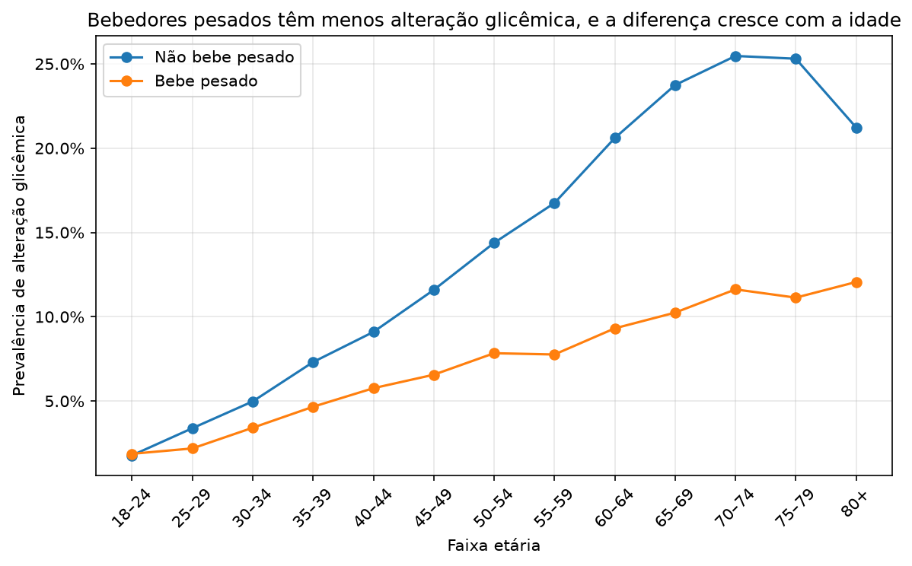
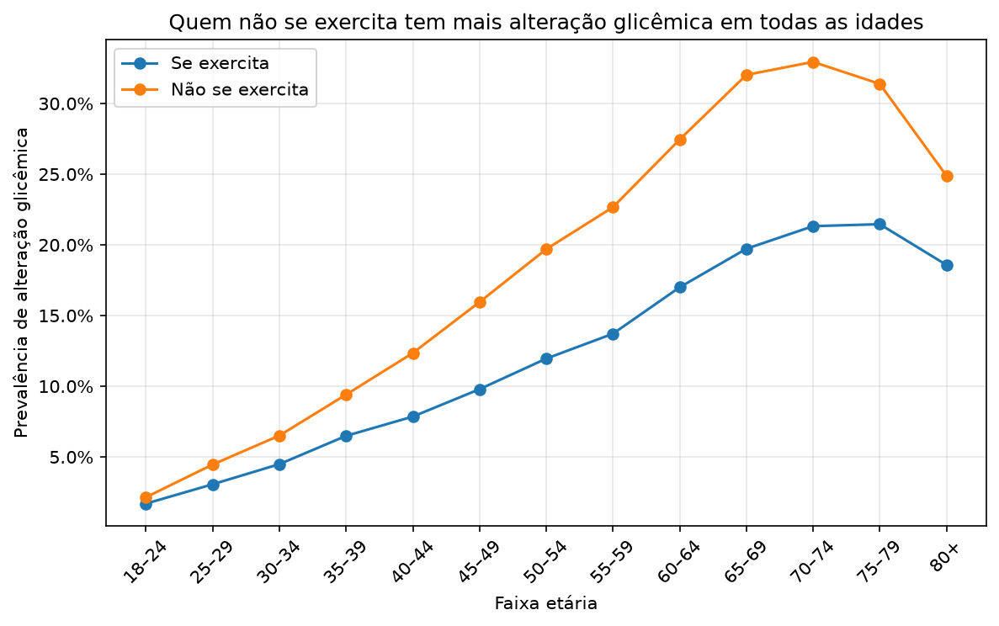
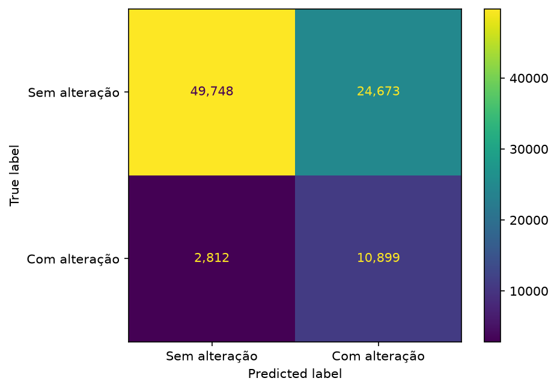
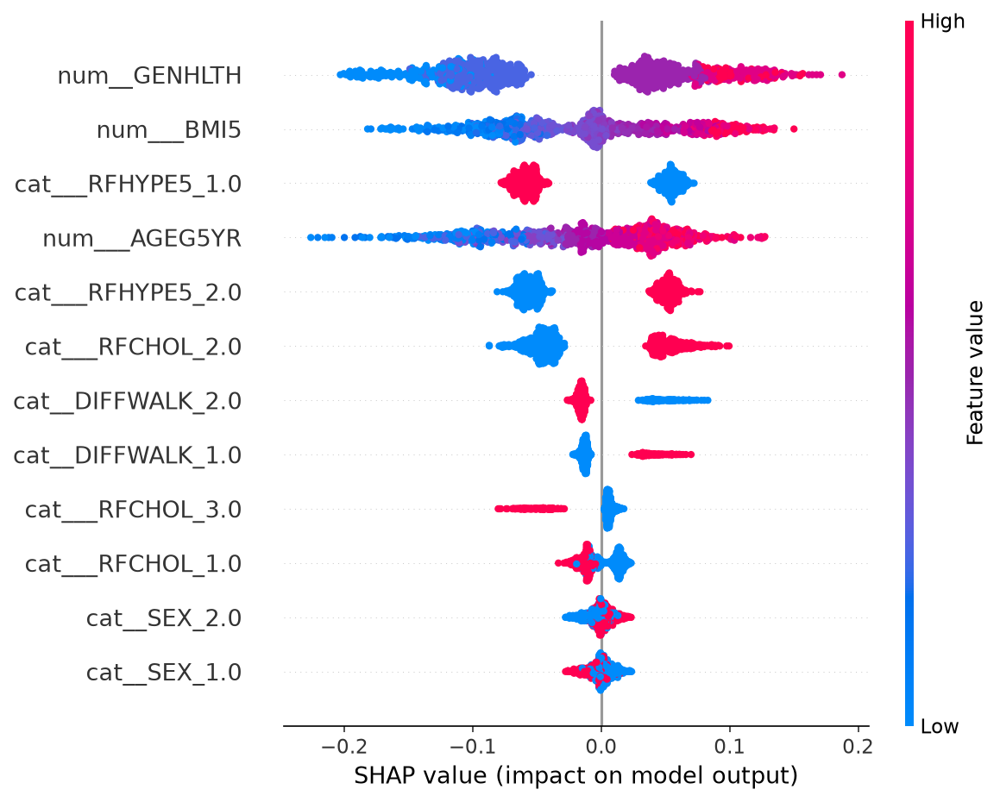

# Relatório técnico: triagem de risco de alteração glicêmica

## 1. Problema

O objetivo é apoiar a triagem hospitalar com um modelo de classificação binária. O recorte escolhido é
um questionário respondido pelo paciente na sala de espera, cujo resultado vai para o médico, que tem
a palavra final. O público são pacientes sem diagnóstico prévio de diabetes.

## 2. Dados

Foi usado o **BRFSS 2015**, pesquisa telefônica autodeclarada do CDC, com 441.456 pessoas e 330 colunas.
O dado bruto foi escolhido porque permite decidir como definir o alvo e tratar os códigos do CDC. Ele
também é autodeclarado, como o questionário que o produto coletaria.

**Alvo.** Positivo: diabetes, diabetes só na gravidez ou pré-diabetes. Negativo: sem diabetes. As linhas
sem rótulo (~0,2%) saíram. O alvo é mais amplo que "tem diabetes" de propósito: na triagem, um falso
positivo custa um exame simples, e um falso negativo adia um diagnóstico. A prevalência resultante é de 15,6%.

**Features.** Das 330 colunas ficaram 10: idade, sexo, IMC, fumo, exercício, consumo pesado de álcool,
colesterol alto, pressão alta, saúde geral e dificuldade para andar. Critérios: o paciente consegue
responder, não há vazamento do alvo, e usa-se uma variável por tema. Ficaram de fora as doenças que
também são consequência do diabetes (cardíaca, AVC e renal), plano de saúde (mede acesso ao diagnóstico)
e renda e escolaridade (risco de discriminação socioeconômica).

## 3. Pré-processamento

**Limpeza**, antes da separação, sem aprender nada dos dados:

- códigos de "não sabe", "recusou" e "ausente" viram NaN;
- o vazio de `_RFCHOL` vira a categoria "não mediu", porque é uma resposta, e não um dado faltante;
- o IMC é dividido por 100, por causa das casas decimais implícitas do CDC.

Foi escolhida a `_SMOKER3` em vez da `SMOKDAY2`: esta é uma pergunta de seguimento, e filtrar seus vazios
eliminaria quem nunca fumou, mais da metade da base.

**Pipeline** (`Pipeline` + `ColumnTransformer`), ajustado só no treino:

- IMC, faixa etária e saúde geral: mediana + `StandardScaler`;
- demais variáveis: valor mais frequente + `OneHotEncoder`.

**Separação:** 60% treino, 20% validação e 20% teste, estratificada, com `random_state=42`.

## 4. Descobertas da análise exploratória

- **Álcool.** Bebedores pesados têm menos da metade da prevalência (7,4% contra 16,2%). A diferença
  persiste dentro das faixas etárias, exceto aos 18–24 anos, e cresce com a idade. É um padrão coerente
  com a causalidade reversa (quem é diagnosticado muda de hábito), mas o dado não permite comprová-la.
- **Exercício.** Quem não se exercita tem mais alteração glicêmica em todas as idades, inclusive aos
  18–24 anos (2,1% contra 1,7%), antes de os diagnósticos se acumularem.
- **Idade.** A prevalência vai de 1,8% para cerca de 25%, e cai depois dos 80 anos, possivelmente por
  viés de sobrevivência.

## 5. Modelos e por quê

Foi usado um baseline de classe majoritária e três modelos com `class_weight="balanced"`, que trata o
desbalanceamento só no treino: Regressão Logística (referência interpretável), Árvore de Decisão (regras
simples) e Random Forest (capta interações e costuma ser robusto). O KNN ficou de fora pelo custo de
previsão em centenas de milhares de linhas.

| Validação | Recall | Precisão | F1 | Accuracy | AUC |
|---|---|---|---|---|---|
| Baseline | 0,000 | 0,000 | 0,000 | 0,844 | 0,500 |
| Regressão Logística | 0,754 | 0,325 | 0,454 | 0,718 | 0,804 |
| Árvore de Decisão | 0,751 | 0,323 | 0,452 | 0,716 | 0,805 |
| Random Forest | 0,760 | 0,327 | 0,458 | 0,720 | 0,811 |

**Métricas.** A principal é o recall da classe positiva, pelo custo assimétrico dos erros. A accuracy não
serve sozinha: o baseline atinge 84,4% sem encontrar nenhum caso.

**Regras definidas antes do teste.** Modelo com a maior AUC na validação (Random Forest) e limiar mais
alto com recall de pelo menos 80% na validação (0,461).

## 6. Resultados no teste

| Recall | Precisão | F1 | Accuracy | AUC | Encaminhados |
|---|---|---|---|---|---|
| 79,5% | 30,6% | 0,442 | 68,8% | 0,807 | 40,4% |

De cada 100 encaminhados, cerca de 31 têm alteração glicêmica, o dobro da prevalência da base.

| Tipo de positivo | Pessoas no teste | Sinalizadas |
|---|---|---|
| Diabetes | 11.472 | 83,6% |
| Pré-diabetes | 1.512 | 72,0% |
| Só na gravidez | 727 | 30,3% |

O modelo praticamente não sinaliza o histórico gestacional: 30,3% está abaixo dos 40,4% da base geral.
Entre os sexos, as métricas são próximas (recall de 81,1% nos homens e 78,3% nas mulheres; precisão de
31,0% e 30,4%).

## 7. Interpretação

O SHAP foi calculado em uma amostra de 1.000 pessoas da validação, por custo computacional. Pressão alta,
saúde geral, colesterol, IMC e idade são as variáveis de maior peso. A idade pesa bem mais que o álcool
(|SHAP| de 0,055 contra 0,008), como previsto na exploração.

Ser bebedor pesado **reduz** o risco estimado (SHAP médio de −0,042), e "nunca mediu o colesterol" também.
Ambos devem ser lidos como associação: o primeiro provavelmente reflete a causalidade reversa, e o segundo
pode refletir menos acesso ao diagnóstico.

## 8. Discussão crítica

O modelo pode apoiar a triagem, mas ainda não está pronto para produção. O uso proposto é sinalizar
pacientes para um exame confirmatório, mostrando ao médico os fatores que pesaram. O diagnóstico continua
sendo do médico.

**Limitações:**

1. **O público de uso não foi avaliado.** O teste mede o reconhecimento de pessoas que já sabem da sua
   condição, e não há evidência direta de que o modelo encontre quem ainda não foi diagnosticado. Antes de
   qualquer uso, seria preciso um estudo com exame de glicemia em pacientes reais.
2. **Causalidade reversa.** Muitos positivos responderam depois do diagnóstico.
3. **Alvo autodeclarado e amplo.** Diabéticos sem diagnóstico aparecem como negativos.
4. **Mudança de população.** Os dados são de adultos dos EUA, em 2015, por telefone, e os pesos amostrais
   não foram usados.
5. **Carga operacional.** Encaminhar 40% dos pacientes pode ser excessivo; o limiar pode ser ajustado, ao
   custo de perder casos.

**Próximos passos:** validar com exames reais, reavaliar o tratamento do código gestacional e calibrar as
probabilidades, caso se queira exibir um risco numérico.
