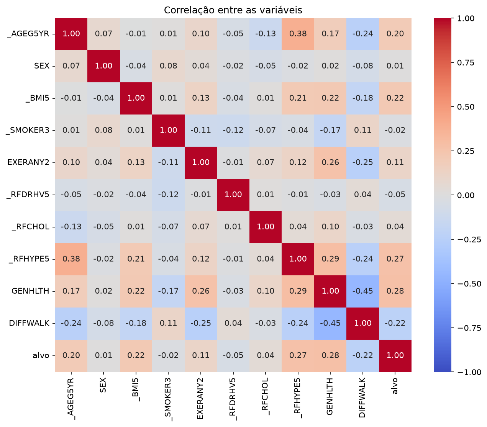
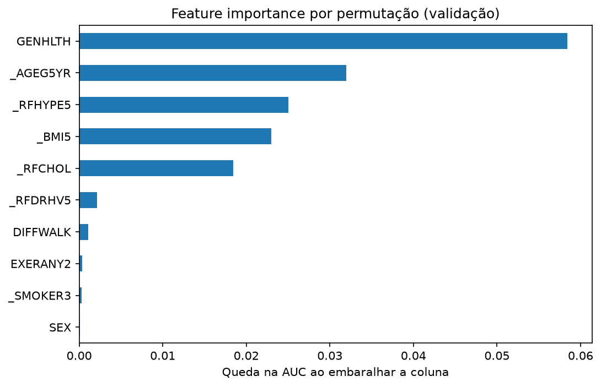

# Relatório técnico: triagem de risco de alteração glicêmica

## 1. Problema

O objetivo é apoiar a triagem hospitalar com um modelo de classificação binária. O recorte escolhido é
um questionário respondido pelo paciente na sala de espera, cujo resultado vai para o médico, que tem
a palavra final. O público são pacientes sem diagnóstico prévio de diabetes.

## 2. Dados

Foi usado o **BRFSS 2015**, pesquisa telefônica autodeclarada do CDC, com 441.456 pessoas e 330 colunas.
O dado bruto foi escolhido porque permite decidir como definir o alvo e tratar os códigos do CDC. Ele
também é autodeclarado, como o questionário que o produto coletaria.

**Alvo.** Positivo: diabetes, diabetes só na gravidez ou pré-diabetes. Negativo: sem diabetes. As linhas
sem rótulo (~0,2%) saíram, restando 440.658. O alvo é mais amplo que "tem diabetes" de propósito: na
triagem, um falso positivo custa um exame simples, e um falso negativo adia um diagnóstico. A prevalência
resultante é de 15,6%.

**Features.** Das 330 colunas ficaram 10: idade, sexo, IMC, fumo, exercício, consumo pesado de álcool,
colesterol alto, pressão alta, saúde geral e dificuldade para andar. Critérios: o paciente consegue
responder, não há vazamento do alvo, e usa-se uma variável por tema. Ficaram de fora as doenças que
também são consequência do diabetes (cardíaca, AVC e renal), plano de saúde (mede acesso ao diagnóstico)
e renda e escolaridade (risco de discriminação socioeconômica).

## 3. Exploração

As análises desta seção são descritivas, usam toda a base e não aplicam os pesos amostrais do BRFSS. Os
percentuais valem para a amostra, e não para a população dos EUA.

**IMC.** A prevalência sobe a cada faixa, de 6,1% para 36,6%, mas os casos negativos são maioria em todas
elas. Quem tem alteração glicêmica se concentra em valores mais altos de IMC, mas isso não significa que
essas pessoas sejam maioria nessas faixas.

| Faixa de IMC | Com alteração | Sem alteração | Prevalência |
|---|---|---|---|
| < 18,5 | 407 | 6.298 | 6,1% |
| 18,5 a 25 | 9.828 | 121.429 | 7,5% |
| 25 a 30 | 20.485 | 126.322 | 14,0% |
| 30 a 35 | 16.837 | 56.360 | 23,0% |
| 35 a 40 | 8.607 | 19.268 | 30,9% |
| ≥ 40 | 6.817 | 11.809 | 36,6% |

A relação é uma associação e não comprova causa. O IMC sozinho também não basta para a triagem: 49% dos
casos com IMC informado estão abaixo de 30.

**Álcool.** Bebedores pesados têm menos da metade da prevalência (7,4% contra 16,2%). A diferença
persiste dentro das faixas etárias, exceto aos 18–24 anos, e cresce com a idade. É um padrão coerente
com a causalidade reversa (quem é diagnosticado muda de hábito), mas o dado não permite comprová-la.

**Exercício.** Quem não se exercita tem mais alteração glicêmica em todas as idades, inclusive aos
18–24 anos (2,1% contra 1,7%), antes de os diagnósticos se acumularem.

**Idade.** A prevalência vai de 1,8% para cerca de 25%, e cai depois dos 80 anos, possivelmente por
viés de sobrevivência.

**Correlação.** As variáveis mais correlacionadas com o alvo são saúde geral (0,28), pressão alta (0,27),
dificuldade para andar (−0,22), IMC (0,22) e idade (0,20). O sinal depende da codificação: em
`DIFFWALK`, 1 significa "sim", então o valor negativo indica mais alteração em quem tem dificuldade. O
maior par entre as features é saúde geral e dificuldade para andar (−0,45), sem redundância que
justificasse remover uma delas. Como a maioria das variáveis é categórica, a correlação de Pearson serve
só como visão inicial.

## 4. Pré-processamento

**Separação:** 60% treino, 20% validação e 20% teste, estratificada, com `random_state=42`. A divisão é
feita uma única vez, e os dois modelos usam as mesmas linhas, o que torna a comparação justa.

**Etapas comuns**, com regras fixas que não aprendem nada dos dados:

- o IMC é dividido por 100, por causa das casas decimais implícitas do CDC;
- o vazio de `_RFCHOL` vira a categoria "sem medição confirmada", e não um dado a imputar: 84% desse grupo nunca mediu o colesterol, e os demais não sabem se mediram ou recusaram responder.

Foi escolhida a `_SMOKER3` em vez da `SMOKDAY2`: esta é uma pergunta de seguimento, e filtrar seus vazios
eliminaria quem nunca fumou, mais da metade da base.

**Pipelines** (`Pipeline` + `ColumnTransformer`), ajustados só no treino:

| | Regressão Logística | Random Forest |
|---|---|---|
| Códigos de "não sabe", "recusou" e "ausente" | viram vazio | ficam como resposta própria |
| Vazios | IMC: mediana; demais: mais frequente | IMC: mediana; demais: mais frequente |
| Categóricas | `OneHotEncoder` | códigos originais |
| IMC | `StandardScaler` | sem escala |

A Regressão Logística soma e multiplica os valores, então os códigos não podem entrar como quantidades. O
Random Forest só faz cortes do tipo "maior ou menor" e consegue separá-los sozinho. O IMC usa a mediana
porque tem cauda longa à direita. Os 1.034 casos com IMC acima de 70 foram mantidos, por não haver
critério objetivo de corte.

## 5. Modelos e por quê

Foram comparados dois modelos: a Regressão Logística, interpretável e referência para dados tabulares, e o
Random Forest, que capta interações entre as variáveis. O KNN ficou de fora pelo custo de previsão em
centenas de milhares de linhas.

**Métricas.** A principal é o recall da classe positiva, pelo custo assimétrico dos erros. O F1 acompanha o
custo dos falsos alarmes, e a AUC compara os modelos sem depender de um limiar. A accuracy não serve sozinha:
um modelo que sempre responde "sem alteração" atinge 84,4% sem encontrar nenhum caso.

| Validação (limiar padrão de 0,5) | Recall | F1 | AUC |
|---|---|---|---|
| Regressão Logística | 0,151 | 0,238 | 0,805 |
| Random Forest | 0,261 | 0,311 | 0,741 |

**Escolha do modelo.** O critério é a maior AUC na validação, o que indica a Regressão Logística. O Random
Forest, com os hiperparâmetros padrão, sofre overfitting: AUC de 0,991 no treino contra 0,741 na validação. A
Regressão Logística fica estável (0,803 e 0,805). O resultado vale para esta configuração, pois o Random
Forest não teve hiperparâmetros ajustados.

**Desbalanceamento e limiar.** Os modelos não usam `class_weight`, o que explica o recall baixo no limiar de
0,5. O desbalanceamento é tratado na decisão: foi escolhido, na validação, o limiar mais alto com recall de
pelo menos 80%. O resultado é **0,133**, com recall de 80,0% e precisão de 30,3% nesse conjunto.

## 6. Resultados no teste

| Recall | Precisão | F1 | Accuracy | AUC | Encaminhados |
|---|---|---|---|---|---|
| 79,7% | 30,1% | 0,437 | 68,0% | 0,801 | 41,2% |

Os valores ficam próximos dos obtidos na validação, sem sinal de overfitting. De cada 100 encaminhados, cerca
de 30 têm alteração glicêmica, quase o dobro da prevalência da base. Dos 13.711 casos positivos, 10.927 foram
sinalizados e 2.784 não foram. Entre os 74.421 negativos, 25.423 receberam encaminhamento.

**Ressalva sobre o teste.** Uma versão anterior do projeto, com outro modelo, já havia sido avaliada no teste
antes de a preparação e o modelo mudarem. Portanto, este não é um primeiro uso do conjunto, e o resultado pode
ser levemente otimista. O limiar atual foi definido só na validação e não foi ajustado depois do teste.

## 7. Interpretação

A interpretação usa a validação. A feature importance por permutação foi calculada em 10 mil linhas, e o SHAP,
em 2 mil, com 100 linhas de referência, para reduzir o tempo de cálculo.

| Variável | Queda na AUC (permutação) | \|SHAP\| médio (log-odds) |
|---|---|---|
| Saúde geral | 0,058 | 0,510 |
| Idade | 0,032 | 0,384 |
| Pressão alta | 0,025 | 0,335 |
| IMC | 0,023 | 0,236 |
| Colesterol | 0,018 | 0,275 |

Os dois métodos apontam as mesmas três variáveis principais. Sexo, tabagismo, exercício e dificuldade para
andar pesam pouco quando as demais já estão no modelo.

**Direção dos efeitos, mantendo as demais variáveis iguais (odds ratio):**

| Comparação | Chance relativa |
|---|---|
| Saúde geral "ruim" contra "excelente" | 6,3 vezes |
| 70–74 anos contra 18–24 | 5,1 vezes |
| Pressão alta | 2,0 vezes |
| Colesterol alto | 1,7 vez |
| Cada 5 pontos de IMC | 1,3 vez |
| Bebedor pesado | 0,5 vez |
| Colesterol sem medição confirmada contra normal | 0,69 vez |

Esses valores são associações. Saúde geral e pressão alta podem refletir o próprio diagnóstico. O efeito
protetor aparente do álcool não significa que beber proteja, e "sem medição" pode refletir menos acesso ao
diagnóstico, e não menos doença. O exercício pesa pouco (1,08 vez), embora a diferença tenha sido clara na
exploração; parte desse efeito provavelmente é absorvida por saúde geral, IMC e idade.

**Equidade (validação).** Homens e mulheres têm resultados próximos: recall de 80,8% e 79,4%, precisão de 30,9%
e 29,8%. Já os tipos de positivo diferem bastante:

| Grupo | Sinalizados |
|---|---|
| Diabetes | 84,2% |
| Pré-diabetes | 70,7% |
| Só na gravidez | 31,9% |
| Sem alteração | 34,0% |

Os casos gestacionais são sinalizados menos do que o grupo sem alteração. Para esse grupo, o modelo praticamente
não funciona como triagem, embora o alvo amplo os inclua de propósito.

## 8. Discussão crítica

O modelo pode apoiar a triagem, mas ainda não está pronto para produção. O uso proposto é sinalizar
pacientes para um exame confirmatório, mostrando ao médico os fatores que pesaram. O diagnóstico continua
sendo do médico.

**Limitações:**

1. **O público de uso não foi avaliado.** O teste mede o reconhecimento de pessoas que já sabem da sua
   condição, e não há evidência direta de que o modelo encontre quem ainda não foi diagnosticado. Antes de
   qualquer uso, seria preciso um estudo com exame de glicemia em pacientes reais.
2. **Causalidade reversa.** Muitos positivos responderam depois do diagnóstico, e seus hábitos atuais podem
   já refletir essa mudança.
3. **Alvo autodeclarado e amplo.** Diabéticos sem diagnóstico aparecem como negativos, e os casos
   gestacionais quase não são detectados.
4. **Mudança de população.** Os dados são de adultos dos EUA, em 2015, por telefone, e os pesos amostrais
   não foram usados.
5. **Carga operacional.** Encaminhar 41% dos pacientes pode ser excessivo; o limiar pode ser ajustado, ao
   custo de perder casos.
6. **Modelos sem ajuste de hiperparâmetros.** O Random Forest poderia ter resultado melhor com profundidade
   limitada, e a comparação vale para a configuração testada.

**Próximos passos:** validar com exames reais, reavaliar o tratamento do código gestacional, ajustar os
hiperparâmetros na validação, reservar um novo conjunto de teste e calibrar as probabilidades, caso se queira
exibir um risco numérico.
